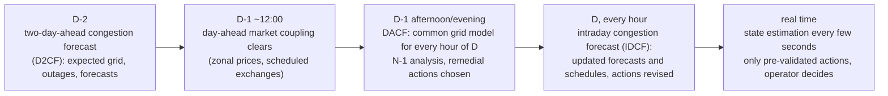

# Chapter 12 – Solutions

Solutions of the Lab and the Exercises of [Chapter 12](index.md). Try each task before reading its solution. The
code is in the chapter's `src` folder: [`congestion_cost.py`](src/congestion_cost.py) (Lab step 1),
[`smard_api.py`](src/smard_api.py) and [`smard_week.py`](src/smard_week.py) (Lab steps 2–3, Exercise 4) and
[`two_node_market.py`](src/two_node_market.py) (Exercises 1–2). Each module's `main()` prints every number quoted
below. The SMARD numbers are those of the week of Monday 12 to Sunday 18 January 2026, fetched from the portal's
JSON API on 16 October 2026 by `smard_api.py` and saved next to it as `smard_live_week_2026-01-12_generation.csv`
and `smard_live_week_2026-01-12_consumption.csv`, in the layout of the download center's CSV export, so everything
below runs offline; the two synthetic samples `smard_generation_sample.csv` and `smard_consumption_sample.csv`
remain as a fully known test input for the parser. Lab step 4 needs a personal ENTSO-E API token and is marked
"not run here".

## Lab

1. **The SMARD article for Q1 2026.** The article (read on 16 October 2026) reports the total volume of congestion
   management measures (redispatch with operational and reserve plants, and countertrading), their estimated cost,
   and the share of the redispatch volume that curtailed renewable plants. In a `DataFrame` indexed by quarter:

    | quarter | volume (GWh) | cost (M€) | curtailment of renewables (GWh) | €/MWh |
    |---|---|---|---|---|
    | Q1 2025 | 9,035 | 882 | 2,153 | 97.62 |
    | Q1 2026 | 8,248 | 784 | 2,215 | 95.05 |

    The average cost is $1000 \times \text{cost}_{\text{M€}} / \text{volume}_{\text{GWh}}$, about 98 €/MWh in Q1 2025
    and 95 €/MWh in Q1 2026, a change of −2.57 €/MWh (−2.6 %). The volume fell by 787 GWh (−8.7 %) and the cost by
    98 M€ (−11.1 %), so the unit cost fell slightly: fewer MWh were moved, and each one cost a little less. The
    article's breakdown shows where the money went (redispatch of conventional plants 423 → 282 M€, compensation of
    curtailed renewables 71 → 55 M€, reserve plants 355 → 430 M€, countertrading 33 → 17 M€; both columns add up
    to the totals). For scale: 95 €/MWh is above the marginal cost of most plants in the merit order, which is why a
    switching action that avoids a MWh of redispatch is worth having even when it costs an hour of an operator's
    attention.

    ```python title="congestion_cost.py"
    --8<-- "docs/part-3-power-systems/ch12-power-grid-operation/src/congestion_cost.py"
    ```

    [Open the `src/` folder on GitHub](https://github.com/CesarBallardini/power-grid-topology-optimization-course/tree/main/docs/part-3-power-systems/ch12-power-grid-operation/src){ target="_blank" } to see or download all the files of this chapter.

2. **One winter week as CSV.** The week is Monday 12 to Sunday 18 January 2026. The SMARD download center writes
   one CSV per table (generation by source; consumption), and the first two lines of each file show everything
   the parser needs: a semicolon as delimiter, a UTF-8 byte-order mark before the first header cell, two
   timestamp columns (`Start date`, `End date`) in Berlin local time, `-` where a value is missing (the whole
   `Nuclear` column, since April 2023), and every value column named `<source> [MWh] Calculated resolutions`.
   Dates and numbers follow the language of the portal: the English export writes `Jan 12, 2026 12:00 AM` and
   `53,862.40`, the German one (`Datum von`, `Netzlast [MWh] Berechnete Auflösungen`) writes `12.01.2026 00:00`
   and `53.862,40`. The parser for the English file is
   `pandas.read_csv(path, sep=';', thousands=',', decimal='.', na_values=['-'], encoding='utf-8-sig')` followed by
   `pandas.to_datetime(..., format='%b %d, %Y %I:%M %p')` on the start column; the German file needs
   `thousands='.'`, `decimal=','` and `format='%d.%m.%Y %H:%M'`. `smard_week.read_smard` picks the layout from the
   first header cell and returns English column names either way (the two real exports of this week were parsed
   with it and agree value for value); the load column of the consumption table is called `grid load`.

    The download center is a form, but the numbers behind the portal's charts come from a JSON API that needs no
    login, and `smard_api.fetch_week` uses it: `index_hour.json` lists the available weeks (Mondays 00:00 Berlin
    time, in milliseconds since the epoch; 616 weeks from 29 December 2014 on the fetch date) and one
    `<filter>_DE_hour_<timestamp>.json` per source gives the 168 hourly values in MWh. The filter ids are those of
    the Bundesnetzagentur's description of the API (410 grid load, 4359 residual load, 4387 pumped-storage
    consumption; 1223 lignite, 1224 nuclear, 1225 wind offshore, 1226 hydropower, 1227 other conventional, 1228
    other renewable, 4066 biomass, 4067 wind onshore, 4068 photovoltaics, 4069 hard coal, 4070 pumped storage,
    4071 natural gas); nuclear answers 404, which the module turns into the `-` column of the export.
    `smard_api.save_week` writes the two tables in the export layout: the saved files are identical to the download
    center's English export of the same week except for the byte-order mark and the line endings. SMARD revises
    recent data, so a later fetch can differ from the saved files in the last decimals.

    Numbers of the week: consumption from 45.7 GW (Sunday 18 January 03:00) to 75.8 GW (Monday 12 January 10:00);
    wind, offshore plus onshore, from 9.1 GW (Saturday 17 January 13:00) to 38.2 GW (Friday 16 January 04:00);
    photovoltaics up to 20.6 GW (Friday 16 January 12:00); wind and solar together supplied 37.7 % of the week's
    consumption. The residual load recomputed as consumption − wind offshore − wind onshore − photovoltaics
    matches SMARD's own `Residual load` column to 0.01 MWh, the rounding of the file, which is the check to run on
    any download. Plots (described, not saved): wind and consumption never cross in this week, but they move
    against each other, wind rising through the nights of Tuesday to Wednesday and Thursday to Friday while
    consumption falls to about 51.5 GW; the residual load runs from 60.5 GW (Wednesday 14 January 18:00, the evening
    peak with little wind) down to 13.5 GW (Friday 16 January 02:00). Its duration curve (`duration_curve`, the 168
    hourly values sorted from largest to smallest) falls from 60.5 GW at hour 1 through 38.2 GW at the median hour
    84 to 13.5 GW at hour 168: in a real January week the thermal fleet is never idle, unlike in the synthetic
    sample, whose right tail drops towards zero.

    ```python title="smard_api.py"
    --8<-- "docs/part-3-power-systems/ch12-power-grid-operation/src/smard_api.py"
    ```

    [Open the `src/` folder on GitHub](https://github.com/CesarBallardini/power-grid-topology-optimization-course/tree/main/docs/part-3-power-systems/ch12-power-grid-operation/src){ target="_blank" } to see or download all the files of this chapter.

    ```python title="smard_week.py"
    --8<-- "docs/part-3-power-systems/ch12-power-grid-operation/src/smard_week.py"
    ```

    [Open the `src/` folder on GitHub](https://github.com/CesarBallardini/power-grid-topology-optimization-course/tree/main/docs/part-3-power-systems/ch12-power-grid-operation/src){ target="_blank" } to see or download all the files of this chapter.

3. **High wind, low residual load.** `critical_hours` marks the hours whose wind is in the top quarter of the week
   (at or above 25.5 GW) and whose residual load is in the bottom quarter (at or below 31.0 GW): 19 hours in the
   week of 12 January 2026, all at night, in three runs: Monday 12 January 05:00; Tuesday 13 January 22:00 to
   Wednesday 14 January 05:00 (8 hours); and Thursday 15 January 21:00 to Friday 16 January 06:00 (10 hours). The
   extreme is Friday 02:00, with 38.1 GW of wind against 51.5 GW of consumption and 13.5 GW of residual load. The
   pattern is that of a windy January week: the wind blows day and night, but demand drops at night, so the hours
   of least residual load are the small hours.

    Why these hours congest the north–south corridors: German wind capacity, offshore and onshore, sits in the
    north, while the large loads and much of the remaining thermal and hydro capacity sit in the south and west.
    When wind is high the northern injections exceed the northern load, and the surplus has to cross the few
    380 kV corridors to the south. When at the same time the residual load is low, the southern thermal plants that
    would otherwise feed the south are out of the market (prices are low), so the south imports even more. The
    corridor flows then reach their limits; the market result is physically infeasible. Operators try the cheapest
    remedies first: switching actions (busbar splitting, line switching) and phase-shifter taps, which redirect flow
    at no fuel cost; then redispatch (curtail northern wind or conventional plants, start southern plants, paid at
    cost) and countertrading with neighbours; renewable curtailment is in principle the last step but, as the Q1
    figures show (2,215 GWh in one quarter), it is routine in these hours.

4. **Cross-border flows (optional).** *Not run here: the RESTful API of the Transparency Platform only answers
   requests that carry a personal security token* (without one, the endpoint below returns HTTP 401 with an
   acknowledgement document whose reason is "Authentication failed."). To get a token: register at
   <https://transparency.entsoe.eu/> (*Sign In* → register, then confirm the address through the e-mail you receive); send an e-mail to
   `transparency@entsoe.eu` with "RESTful API access" as subject and the registered address in the body; access
   is granted within three working days; then *My Account* → *Generate a new token* shows it (the helpdesk
   article "How to get security token",
   <https://transparencyplatform.zendesk.com/hc/en-us/articles/12845911031188-How-to-get-security-token>, has the
   screenshots). The production endpoint is `https://web-api.tp.entsoe.eu/api`, and the physical flows are the
   `A11` document (*Aggregated energy data report*), listed as *12.1.G Cross-Border Physical Flows* under
   *Transmission* in the platform's Postman reference
   (<https://documenter.getpostman.com/view/7009892/2s93JtP3F6>), one request per neighbour and direction:

    ```text
    https://web-api.tp.entsoe.eu/api?securityToken=<token>&documentType=A11
        &out_Domain=10Y1001A1001A83F&in_Domain=10YNL----------L
        &periodStart=202601112300&periodEnd=202601182300
    ```

    `out_Domain` is the area the energy leaves and `in_Domain` the one it enters (here Germany to the
    Netherlands; swap the two for the opposite direction, the net export is the difference), each an EIC code:
    Germany `10Y1001A1001A83F`, Netherlands `10YNL----------L`, Belgium `10YBE----------2`, France
    `10YFR-RTE------C`, Austria `10YAT-APG------L`, Czech Republic `10YCZ-CEPS-----N`, Poland `10YPL-AREA-----S`,
    Switzerland `10YCH-SWISSGRIDZ`, western Denmark `10YDK-1--------W`. The period is UTC in `yyyyMMddHHmm`, so
    the Berlin week of 12 January 00:00 starts at 11 January 23:00 UTC; the timestamps of the answer are UTC too.
    The answer is XML with one `<Point>` per time step (`position`, `quantity` in MW; the step, `PT60M` or `PT15M`, is in the
    `<resolution>` element); `pandas.read_xml` or the `entsoe-py` package
    (`EntsoePandasClient.query_crossborder_flows`) turns it into a series. On the website the same data item,
    *Cross-Border Physical Flows* (item 12.1.G), has an export function, one border at a time. What to look for: in
    the 19 hours of step 3 Germany should be exporting strongly towards the Netherlands, Poland, the Czech
    Republic and Austria, and part of that export is north–south transit through the neighbours ("loop
    flows"), which is exactly the cross-border congestion the coordinated processes of
    [Chapter 21](../ch21-coordinated-security-rao/index.md) are meant to manage.

## Exercise 1

**(a) Nodal pricing.** The cheap generator at A can send at most 500 MW over the line, so it is dispatched at 500
MW; the remaining 300 MW of the 800 MW load are generated at B. The price at each node is the cost of the generator
that would serve one more MW there: 20 €/MWh at A (its generator has 500 MW spare but cannot reach B) and 60 €/MWh
at B. The congestion rent is the price difference times the flow:

$$
R = (\lambda_B - \lambda_A)\, F = (60 - 20) \times 500 = 20{,}000 \text{ €/h}.
$$

It is what the load pays (800 × 60 = 48,000 €/h) minus what the generators receive (500 × 20 + 300 × 60 =
28,000 €/h), and accrues to the owner of the line (or to the holders of its financial transmission rights).

**(b) Zonal market.** Without the limit the merit order dispatches the cheap generator for the whole load, 800 MW
from A, 0 from B, at a single price of 20 €/MWh. The line would carry 800 MW, 300 MW too many. The operator buys
300 MW down at A and 300 MW up at B; in cost-based redispatch it pays B's cost and recovers A's saved fuel, a net
cost of

$$
300 \times (60 - 20) = 12{,}000 \text{ €/h},
$$

which falls on the grid tariff instead of on the market price. The final physical dispatch (500, 300) is the same
as in (a); what differs is who pays: in the nodal market the load at B pays 60 €/MWh and the rent goes to the grid,
in the zonal market the load pays 20 €/MWh and the grid pays 12,000 €/h. `two_node_market.nodal()` and
`two_node_market.zonal()` reproduce these numbers.

```python title="two_node_market.py"
--8<-- "docs/part-3-power-systems/ch12-power-grid-operation/src/two_node_market.py"
```

[Open the `src/` folder on GitHub](https://github.com/CesarBallardini/power-grid-topology-optimization-course/tree/main/docs/part-3-power-systems/ch12-power-grid-operation/src){ target="_blank" } to see or download all the files of this chapter.

## Exercise 2

*GeoGebra construction not run here*; the same functions are evaluated in Python by `two_node_market.sweep`, and
the GeoGebra sliders only change the two parameters $L$ (line limit) and $D$ (load at B). With $c_A = 20$,
$c_B = 60$ and the generator at A large enough,

$$
\text{redispatch cost}(L) = (c_B - c_A)\,\max(0,\, D - L), \qquad
\text{rent}(L) = \begin{cases} (c_B - c_A)\, L & L < D \\ 0 & L \ge D \end{cases}
$$

| limit (MW) | 0 | 200 | 400 | 500 | 600 | 799 | 800 | 1,000 |
|---|---|---|---|---|---|---|---|---|
| redispatch cost (€/h) | 32,000 | 24,000 | 16,000 | 12,000 | 8,000 | 40 | 0 | 0 |
| congestion rent (€/h) | 0 | 8,000 | 16,000 | 20,000 | 24,000 | 31,960 | 0 | 0 |

The kink is at $L = D = 800$ MW. Below it the line is congested: every extra MW of capacity saves 40 €/h of
redispatch, so the cost falls with slope $-(c_B - c_A)$, and the rent grows with slope $+(c_B - c_A)$ because one
more MW flows at the full 40 €/MWh price difference. At $L = D$ the congestion disappears: the redispatch cost
reaches zero and stays there (a kink, continuous but with a slope change from −40 to 0), while the rent does not
decline gradually but jumps from 31,960 €/h to 0, because the price difference itself collapses from 40 €/MWh to
zero the moment the constraint stops binding. Moving the load slider moves the kink: it is always at the load (or
at the capacity of A, if that is smaller). In GeoGebra, define `L` and `D` as sliders, `cost(x) = 40 max(0, D − x)`,
`rent(x) = If(x < D, 40 x, 0)`, and watch the kink follow `D`.

## Exercise 3

The planning timeline, from two days ahead (D-2) to real time, with the time a topology optimization has at
each stage:



| Stage | When | What is fixed | What can still change | Time for a ToOp run |
|---|---|---|---|---|
| D2CF | D-2 | planned outages, load and renewable forecasts | everything about the dispatch | hours; results are indicative |
| day-ahead market | D-1, around noon | zonal dispatch and exchanges | the grid topology and remedial actions | – |
| DACF | D-1 afternoon to evening | one grid model per hour of D, N-1 results | topology (bus splits, line switching), PST taps, then redispatch | an hour or more per batch of 24 hourly models: this is where ToOp runs |
| IDCF | D, hourly | forecasts updated with the latest measurements | the same actions, re-checked | tens of minutes per update |
| real time | D, continuously | the actual state (state estimator) | switching actions already validated, redispatch activation | none for optimization; seconds for the operator to act |

A ToOp run belongs to the DACF and to the intraday updates: it needs a converged grid model (the common grid
model built after the market result) and an N-1 analysis to improve, and its output, a list of proposed
splittings with their security metrics and switching distances, must be validated (AC check, operator judgement)
before it can be executed. At D-1 evening the engine has hours for 24 hourly cases; intraday it must answer in
tens of minutes; in real time nothing is optimized any more, the operator only applies actions that were
already studied. This is why the chapters on the solver stress speed per topology ([Chapter 31](../../part-5-computing/ch31-jax-gpu-fundamentals/index.md)):
the budget is set by the timeline, not by the algorithm.

## Exercise 4

Numbers of the week of 12–18 January 2026 (`smard_week.daily_summary` on the tables that `smard_api` fetched).
The daily share of wind and solar in consumption is the ratio of daily sums, the ramp is the largest absolute
hour-to-hour change of the residual load within the day:

| day | wind + solar share (%) | max residual ramp (MW/h) | min residual load (MW) |
|---|---|---|---|
| Monday 12 Jan | 36.6 | 7,293 | 26,538 |
| Tuesday 13 Jan | 36.9 | 8,012 | 22,590 |
| Wednesday 14 Jan | 37.0 | 6,846 | 19,161 |
| Thursday 15 Jan | 43.1 | 7,283 | 20,101 |
| Friday 16 Jan | 43.4 | 8,963 | 13,452 |
| Saturday 17 Jan | 28.0 | 3,819 | 35,323 |
| Sunday 18 Jan | 37.5 | 4,821 | 27,611 |

Friday 16 January is the hardest day on every count. It has the highest share (43.4 %), the lowest residual load
of the week (13.5 GW at 02:00, with 38 GW of wind in the night: 7 of the 19 critical hours of Lab step 3 fall on
it) and the largest ramp, +9.0 GW in the hour ending 15:00, when the week's highest solar arc (20.6 GW at noon)
fades while the evening demand builds up: the operator who spent the night managing north–south flows with the
thermal fleet near its floor must bring that fleet back by 9 GW within one hour the same afternoon. Thursday is
the runner-up, with 43.1 % and the start of the same windy night. Saturday is the opposite case: the week's
weakest wind (9.1 GW at 13:00), a 28 % share, the highest residual-load floor (35.3 GW) and the smallest ramps;
congestion is not the problem that day, the thermal fleet simply carries the load. In general the day of minimum
residual load is the hard one for *congestion* (the question of this chapter) and the day of maximum ramp the
hard one for *balancing*; in this week both fall on the same day, a windy night followed by a sunny afternoon,
which is the combination operators plan for most carefully.

## Exercise 5

Ranking from cheapest to most expensive, and from fastest to slowest to activate; the two orders are nearly
reversed, which is the whole point of putting topology first in the remedial-action list:

| Remedial action | Cost per MW relieved | Speed of activation | Market participant involved |
|---|---|---|---|
| Busbar splitting, line switching | lowest: no fuel, only switching wear and operator time; the risk is a worse N-1 state afterwards | minutes (remote switching), but only after an N-1 check of the new topology, so hours of preparation in the DACF | no: entirely within the TSO |
| Phase-shifter tap change | very low: no fuel, mechanical wear of the tap changer | one tap every few seconds to minutes; also coordinated with neighbours when the PST sits on a border | no (TSO, or two TSOs for a border PST) |
| Redispatch (conventional plants) | high: the cost difference between the plants moved, about 95 €/MWh on average in Q1 2026 (Lab step 1) | from a quarter of an hour (gas, hydro) to several hours (coal start-up); it is planned day-ahead and intraday | yes: the plant operators, compensated at cost |
| Countertrading | high: the price difference between the two zones, paid on the intraday market | roughly the intraday gate closure, an hour or less | yes: traders in both zones |
| Renewable curtailment | high per MWh and the most visible: lost zero-cost energy, compensation of the plant owner (55 M€ for 2,215 GWh in Q1 2026) | fast once instructed (minutes), but legally the last resort after conventional measures | yes: the renewable plant operators, compensated |

The German figures of Lab step 1 show the asymmetry: topology changes and PST taps cost almost nothing per MWh and
do not appear in the cost table at all, while the three market-based measures cost 784 M€ in a quarter. That is
why an engine that finds a switching action for a congestion, instead of paying for redispatch, pays for itself
after a few hours of operation.
