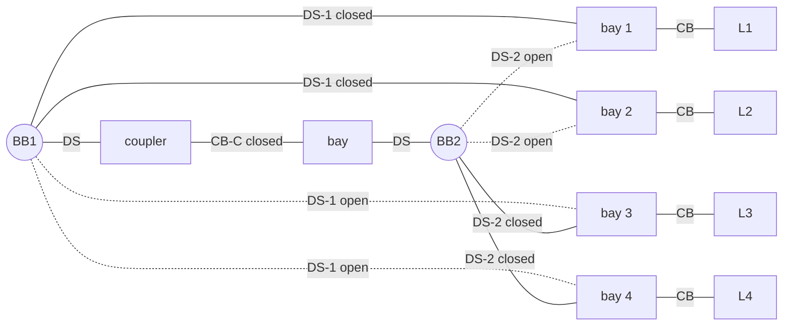

# Chapter 13 – Solutions

Solutions of the Lab and the Exercises of [Chapter 13](index.md). Try each task before reading its solution. The
code is in the chapter's `src` folder: [`coupler_splits.py`](src/coupler_splits.py) (the worked example),
[`reassignment_distance.py`](src/reassignment_distance.py) (Exercise 4 and the station used in the Lab),
[`ring_splits.py`](src/ring_splits.py) (Exercise 3), [`four_substations.py`](src/four_substations.py) (Exercise 5)
and [`station_toop.py`](src/station_toop.py), which runs ToOp's own `prepare_for_separation_set`,
`make_optimal_separation_set` and `per_station_switching_distance` (Lab steps 1–4; ToOp's interpreter only). The
ToOp numbers were produced with ToOp `ba1874e` on CPU; each module's `main()` prints every number quoted below.

## Lab

The lab names the interactive ToOp notebook `notebooks/example_asset_topology_analysis.ipynb`. Its widgets and
single-line diagrams need a browser session and are *not run here*; the same materialization of a node-breaker
network into ToOp's bus groups, without widgets, is what `station_toop.four_substations_bus_groups` does, with
the functions the notebook itself imports (`get_node_breaker_master_asset_topology`,
`materialize_runtime_bus_groups_from_network_state`). The network is pypowsybl's four-substations node-breaker
example, the one Exercise 5 also uses.

1. **Node-breaker graph of a voltage level.** The five voltage levels of the example become five bus groups. Four
   of them (S1VL1, S2VL1, S3VL1, S4VL1) have a single busbar section and no coupler: ToOp logs "No couplers found
   in the substation" and they cannot be split. S1VL2, the 400 kV level of substation S1, is a double busbar:

    | busbar | int_id | bays closed onto it |
    |---|---|---|
    | `S1VL2_BBS1` | 0 | `TWT` (branch), `GH1`, `GH2`, `GH3`, `SHUNT` |
    | `S1VL2_BBS2` | 1 | `LCC1`, `LD2`, `LD3`, `LD4`, `VSC1` |

    joined by the coupler `S1VL2_COUPLER` (a breaker, closed, between int_ids 0 and 1, with a disconnector on each
    side). Every bay is a breaker plus one busbar disconnector per busbar section (the 33 switches of Exercise 5).
    In the single-line diagram the two horizontal busbar sections, the coupler between them and the ten bays
    hanging from them are exactly these objects; the bus-branch model sees one bus (the coupler is closed) with
    one branch and nine injections.

2. **Coupler states by hand.** S1VL2 has one coupler and two busbars, so $2^1 = 2$ states: coupler closed, one
   electrical busbar (the current state, skipped); coupler open, two electrical busbars $\{\text{BBS1}\} \mid
   \{\text{BBS2}\}$. One candidate. For the worked example's chain of four busbars and three closed couplers,
   `coupler_splits.two_node_configurations` lists the three states with exactly one coupler open: open $c_{01}$
   gives $\{b_0\} \mid \{b_1 b_2 b_3\}$, open $c_{12}$ gives $\{b_0 b_1\} \mid \{b_2 b_3\}$, open $c_{23}$ gives
   $\{b_0 b_1 b_2\} \mid \{b_3\}$. With six line bays L0, L1 on $b_0$, L2 on $b_1$, L3 on $b_2$ and L4, L5 on $b_3$
   (`reassignment_distance.ASSET_BUSBAR`), the candidates are A = {L0 L1} | B = {L2 L3 L4 L5}, A = {L0 L1 L2} |
   B = {L3 L4 L5} and A = {L0 L1 L2 L3} | B = {L4 L5}.

3. **ToOp's separation set.** `station_toop.separation` runs `prepare_for_separation_set` (nothing to fix:
   `StationProblems` is empty for both stations) and `make_optimal_separation_set`. For S1VL2 the separation set
   has shape (1, 2, 1): one configuration, two busbars, one *branch* asset (the table covers the branches, `TWT`
   on bus A, so `[[1], [0]]`), with `coupler_states = [[True]]` (the coupler must be open), `busbar_a = [{0}]` and
   `coupler_distance = [1]`, since the coupler is closed today. For the chain station the set has three
   configurations, in ToOp's order the same three splits as the hand enumeration (the script checks every row
   against `coupler_splits`, mirror images allowed, and prints `same candidates as coupler_splits: True`):

    | coupler state (True = open) | busbars in A | bus A | bus B |
    |---|---|---|---|
    | $c_{01}$ open | {0} | L0 L1 | L2 L3 L4 L5 |
    | $c_{12}$ open | {0, 1} | L0 L1 L2 | L3 L4 L5 |
    | $c_{23}$ open | {0, 1, 2} | L0 L1 L2 L3 | L4 L5 |

    `make_optimal_separation_set` removes nothing: the three rows are distinct even up to the A/B mirror, and
    with fewer than `clip_at_size = 100` rows no Hamming clipping applies.

4. **Switching distance of a target.** All couplers are closed today (`current_coupler_state = [F, F, F]`).
   `station_toop.switching_distance` calls `per_station_switching_distance`; the pure NumPy
   `reassignment_distance.reassignment_distance` gives the same reassignment count in every case:

    | target (True = on bus B) | best configuration | inverted | reassignment | coupler |
    |---|---|---|---|---|
    | L3 L4 L5 on B | 1 ($c_{12}$ open) | no | 0 | 1 |
    | L3 L4 on B, L5 on A | 1 ($c_{12}$ open) | no | 2 | 1 |
    | L0 L1 L2 on B (the mirror of the first) | 1 ($c_{12}$ open) | yes | 0 | 1 |

    By hand: the first target *is* the second candidate, so no bay changes busbar, and the only physical
    operation is opening $c_{12}$, one coupler switching. In the second target L5 must leave the group of
    $b_3$ for the other side: its connection to a bus-B busbar is opened and a connection to a bus-A busbar is
    closed, two reassignment operations, plus the coupler. The third target is the first one with the names A
    and B exchanged; without the swap it would cost 12 (every one of the six bays on both rows), with it ToOp
    reports `invert = True` and distance 0, which is the reason the minimum over both labelings exists.

    ```python title="station_toop.py"
    --8<-- "docs/part-3-power-systems/ch13-substations-grid-models/src/station_toop.py"
    ```

    [Open the `src/` folder on GitHub](https://github.com/CesarBallardini/power-grid-topology-optimization-course/tree/main/docs/part-3-power-systems/ch13-substations-grid-models/src){ target="_blank" } to see or download all the files of this chapter.

## Exercise 1

The station: two busbars BB1 and BB2, four line bays L1–L4 and one coupler bay. In a double-busbar,
single-breaker arrangement each line bay has one circuit breaker CB and two busbar disconnectors, DS-1 towards
BB1 and DS-2 towards BB2 (plus a line disconnector on the line side, which plays no part here); the coupler bay
has a breaker CB-C with a disconnector on each side. Take L1, L2 on BB1 and L3, L4 on BB2 with the coupler
closed.

**Node-breaker.** Every conductor segment is a node and every switch is an edge between two nodes. Per line bay:
node $n_\text{line}$ (the line end), edge CB to node $n_\text{bay}$ (the busbar-side segment), edge DS-1 from
$n_\text{bay}$ to BB1 and edge DS-2 from $n_\text{bay}$ to BB2, one of them closed. The coupler bay is the path
BB1 – DS – $n_c$ – CB-C – $n_c'$ – DS – BB2. In total 2 busbar nodes, 4 × 2 bay nodes, 2 coupler nodes and 4 × 3 +
3 = 15 switches (plus the four line disconnectors if drawn), exactly the pattern of S1VL2 in Exercise 5.



**Bus-breaker.** Disconnectors are resolved: each bay is attached to the busbar whose disconnector is closed, and
only the breakers remain as switches. Two buses, BB1 with L1 and L2 and BB2 with L3 and L4, each line behind its
breaker, and the coupler breaker between the two buses. This is the view pypowsybl's bus-breaker voltage levels
keep and the one ToOp's `RuntimeBusGroup` encodes: a `branch_switching_table` with a row per busbar (here
`[[1, 1, 0, 0], [0, 0, 1, 1]]`) and the list of couplers with their open/closed state.

**Bus-branch.** Closed breakers disappear too, and busbars joined by a closed coupler merge: one bus with the
four lines (the unsplit station). With the coupler open there are two buses, {L1, L2} and {L3, L4}, which is
what a power flow or ToOp's DC solver sees, and nothing else: the bus-branch model cannot tell which physical
busbar a line is on, only which electrical node.

**Moving L3 from BB2 to BB1.** With the coupler closed (BB1 and BB2 at the same potential), close DS-1 of bay 3,
then open DS-2 of bay 3: two switch operations in the node-breaker model, none in the bus-branch model (the
electrical topology is unchanged while the coupler is closed). ToOp counts exactly these two, one connection
closed and one opened, as a reassignment distance of 2 (Exercise 4); if the coupler were open it would first
have to be closed, and that operation counts in the coupler distance. If the goal is a split with L3 on the BB1
side, the coupler is opened afterwards (one more operation, the coupler distance of Lab step 4).

## Exercise 2

A disconnector (isolator) is a slow, air-insulated knife switch without an arc-quenching chamber. Opening a
circuit that carries load current draws an arc; a circuit breaker extinguishes it with SF₆, vacuum or oil and a
fast mechanism, a disconnector cannot, so the arc would persist, re-strike and flash over to earth or to the other
phases. Disconnectors are therefore rated to open and close only *de-energized* circuits or circuits that carry
no current to interrupt, and their task is isolation (a visible gap for maintenance) and selection (which busbar a
bay uses), not switching. Interlocks in the substation enforce this: a busbar disconnector cannot be operated
unless either its bay breaker is open or a parallel path at the same potential exists.

For a busbar reassignment under load the parallel path is the coupler. The sequence is "make before break":

1. Close the coupler breaker (if it was open): BB1 and BB2 are now one electrical node at the same voltage.
2. Close the disconnector of the bay towards the new busbar: it closes between two points at the same potential,
   so no current flows through it at the moment of closing and nothing has to be interrupted.
3. Open the disconnector towards the old busbar: the bay current it carried diverts through the new disconnector,
   the new busbar and the coupler, so again it interrupts no load current (only a small circulating current,
   within the rating of the disconnector).
4. Repeat for every bay that moves; then, if the intention is to split the station, open the coupler *breaker*,
   the one device in the sequence that interrupts a real current.

Consequences for the switching distance: a bay reassignment always costs two disconnector operations (ToOp's
reassignment distance of 2 per moved asset), the coupler must be closed during the move, and a split is only
completed by a breaker, so the coupler distance is counted separately. It also fixes the order in time: the
reassignments come first and the coupler opens last, which is why a target split cannot be reached with fewer
operations than ToOp's reassignment plus coupler count.

## Exercise 3

A ring of $n$ busbars with $n$ couplers (busbar $i$ joined to busbar $i + 1 \bmod n$) stays connected with one
coupler open (a chain) and falls into exactly two groups when exactly two couplers are open; a third open coupler
makes three groups. Hence the two-component states are the ways of choosing the two open couplers,
$\binom{n}{2}$. `ring_splits.count_two_component_states` runs the brute force of the worked example
(`coupler_splits.two_node_configurations` over all $2^n$ states) and `closed_form` gives $\binom{n}{2}$; they
agree for every $n$ from 3 to 16 (the test checks 3–10):

| $n$ | states $2^n$ | two-component states | $\binom{n}{2}$ | seconds |
|---|---|---|---|---|
| 3 | 8 | 3 | 3 | 0.000 |
| 4 | 16 | 6 | 6 | 0.000 |
| 6 | 64 | 15 | 15 | 0.001 |
| 8 | 256 | 28 | 28 | 0.003 |
| 10 | 1,024 | 45 | 45 | 0.015 |
| 12 | 4,096 | 66 | 66 | 0.073 |
| 14 | 16,384 | 91 | 91 | 0.307 |
| 16 | 65,536 | 120 | 120 | 1.333 |

The times are from one run on the maintainer's laptop and vary by machine, but the growth does not: each extra
coupler doubles the number of states and the time, while the number of useful states grows only quadratically.
Extrapolating the last row, $n = 20$ takes about $1.33 \times 2^4 \approx 21$ s and $n = 30$ about six hours.
That is why `make_separation_set` refuses stations with more than 20 couplers: a brute force over coupler states
is affordable for the handful of couplers a real station has, and the limit guards against a mis-modelled station
(for example, every bay disconnector counted as a coupler) rather than against a real design.

```python title="ring_splits.py"
--8<-- "docs/part-3-power-systems/ch13-substations-grid-models/src/ring_splits.py"
```

[Open the `src/` folder on GitHub](https://github.com/CesarBallardini/power-grid-topology-optimization-course/tree/main/docs/part-3-power-systems/ch13-substations-grid-models/src){ target="_blank" } to see or download all the files of this chapter.

## Exercise 4

With the candidates as a Boolean array `cands` of shape (candidates, 2, assets) and the target `t` (True = on
bus B), the distance of every candidate, with and without the swap, is one expression each:

```python
direct  = (cands[:, 0] ^ ~t).sum(axis=1) + (cands[:, 1] ^ t).sum(axis=1)
swapped = (cands[:, 0] ^ t).sum(axis=1) + (cands[:, 1] ^ ~t).sum(axis=1)
distance = np.minimum(direct, swapped)
```

Bus A is compared with the complement of the target (the assets that should *not* be on B) and bus B with the
target; broadcasting does it for all candidates at once. For the worked example's station (six bays, candidates
A = {L0 L1} | B = {L2 L3 L4 L5}, A = {L0 L1 L2} | B = {L3 L4 L5}, A = {L0 L1 L2 L3} | B = {L4 L5}) and the
target "L3 L4 L5 on bus B" the distances are `[2, 0, 2]` with or without the swap: the second candidate is the
target, and the neighbours differ by one bay, which counts twice (one connection to open, one to close).

**Where ignoring the swap overstates.** Take the mirror target "L0 L1 L2 on bus B", the same split with the
names of the two buses exchanged. Without the swap the distances are `[10, 12, 10]`: bus A of the second
candidate disagrees with $\bar t$ on all six assets and bus B disagrees with $t$ on all six, although not a single
bay has to move. With the swap they are `[2, 0, 2]` again. The names A and B are arbitrary labels of the two
electrical nodes, so a distance that depends on them would make the engine pay twelve switching operations for
renaming; this is what the `invert` flag of `per_station_switching_distance` records (Lab step 4). In general,
without the swap the distance of a candidate to its own mirror is $2m$ for $m$ assets, the maximum possible,
instead of 0.

```python title="reassignment_distance.py"
--8<-- "docs/part-3-power-systems/ch13-substations-grid-models/src/reassignment_distance.py"
```

[Open the `src/` folder on GitHub](https://github.com/CesarBallardini/power-grid-topology-optimization-course/tree/main/docs/part-3-power-systems/ch13-substations-grid-models/src){ target="_blank" } to see or download all the files of this chapter.

## Exercise 5

`pypowsybl.network.create_four_substations_node_breaker_network()` has four substations and five voltage levels,
all node-breaker: S1VL1 (225 kV) and S1VL2 (400 kV) in S1, and S2VL1, S3VL1, S4VL1 (400 kV). `net.get_switches()`
lists 59 switches with their `kind`, `open` and `retained` flags; `net.get_node_breaker_topology(vl)` adds the
two nodes of each switch and which nodes are busbar sections:

| voltage level | breakers | disconnectors |
|---|---|---|
| S1VL1 | 2 | 2 |
| S1VL2 | 11 | 22 |
| S2VL1 | 3 | 3 |
| S3VL1 | 5 | 5 |
| S4VL1 | 3 | 3 |

The single-busbar levels have one breaker and one disconnector per bay. S1VL2 is the double busbar of the Lab:
`four_substations.classify_switches` separates its 33 switches by kind and by the node they touch (a disconnector
that touches a busbar-section node is a busbar selector):

| kind | role | count |
|---|---|---|
| BREAKER | bay breaker (`S1VL2_<asset>_BREAKER`) | 10 |
| BREAKER | coupler (`S1VL2_COUPLER`) | 1 |
| DISCONNECTOR | busbar disconnector (`S1VL2_BBS1_<asset>_DISCONNECTOR`, `S1VL2_BBS2_<asset>_DISCONNECTOR`) | 20 |
| DISCONNECTOR | coupler disconnector (`S1VL2_BBS1_COUPLER_DISCONNECTOR`, `S1VL2_BBS2_COUPLER_DISCONNECTOR`) | 2 |

Ten bays (TWT, GH1–GH3, LD2–LD4, SHUNT, LCC1, VSC1), each with a breaker and two busbar disconnectors, one per
busbar section, and the coupler bay with its breaker and two disconnectors: the textbook double-busbar,
single-breaker arrangement of Exercise 1, and the only level of the example that ToOp can split (Lab step 3). All
eleven breakers are `retained`, so pypowsybl keeps them as switches in its bus-breaker view, while the
disconnectors are resolved into the bus a bay belongs to.

```python title="four_substations.py"
--8<-- "docs/part-3-power-systems/ch13-substations-grid-models/src/four_substations.py"
```

[Open the `src/` folder on GitHub](https://github.com/CesarBallardini/power-grid-topology-optimization-course/tree/main/docs/part-3-power-systems/ch13-substations-grid-models/src){ target="_blank" } to see or download all the files of this chapter.
