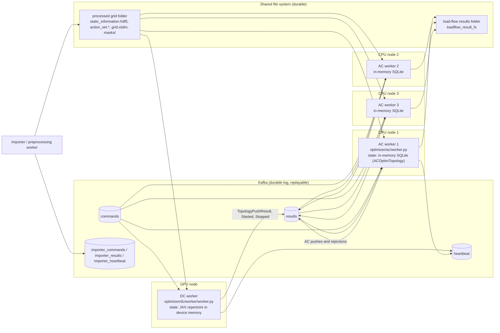

# Chapter 34 – Solutions

Solutions of the Lab and the Exercises of [Chapter 34](index.md). Try each task before reading its solution. The
code is in the chapter's `src` folder: [`mini_pipeline.py`](src/mini_pipeline.py) (the message-to-database hop
with the standard library, runs anywhere), [`shm_fill.py`](src/shm_fill.py) (standard library, meant for the
container) and six programs that need ToOp's interpreter,
[`folder_contract_toop.py`](src/folder_contract_toop.py), [`fake_pipeline_toop.py`](src/fake_pipeline_toop.py),
[`tensorboard_log_toop.py`](src/tensorboard_log_toop.py), [`tyro_flags_toop.py`](src/tyro_flags_toop.py),
[`hydra_sweep_toop.py`](src/hydra_sweep_toop.py) and [`ray_store_toop.py`](src/ray_store_toop.py). Every number
below was printed by one of them (`python <name>.py`), with ToOp commit `ba1874e` on the CPU of the maintainer's
Windows machine, not in the container, except in Exercise 5, which was run in the ToOp container and quotes
`docker run` output there; the ToOp programs read ToOp's tracked `data/` folders and write only to temporary
folders. The worked examples run in
[examples.ipynb](src/examples.ipynb); the lab's notebook, [lab_toop.ipynb](src/lab_toop.ipynb), needs ToOp.

Three things about ToOp `ba1874e` on Windows had to be worked around in the code, and are findings in their own
right: `dc/main.py` names the TensorBoard folder `str(datetime.datetime.now())`, whose colons Windows rejects
(`WinError 123`; `tensorboard_log_toop.windows_safe_log_dir` swaps that module's `datetime` for one that prints
dashes, as the course fork's fix does); `ga_helpers.update_running_means` divides by the wall-clock time between
epochs, which is zero when an epoch is shorter than the 15.6 ms tick of Python 3.11's `time.time()` on Windows
(`ZeroDivisionError`; a larger `iterations_per_epoch` avoids it); and tyro's `--help` draws box characters that a
cp1252 console cannot encode (`PYTHONUTF8=1`).

## Lab

1. **The on-disk contract.** `folder_contract_toop.list_folder` walks `data/case57_data_powsybl` and looks each
   file up in `PREPROCESSING_PATHS` and `NETWORK_MASK_NAMES`; the writer and reader columns come from the uses of
   each constant in ToOp's packages:

    | File | Key | Written by | Read by |
    |---|---|---|---|
    | `grid.xiidm` | `grid_file_path_powsybl` | importer (`pypowsybl_import/preprocessing.py`) | preprocessing (`powsybl_backend.py`), AC (`ac/optimizer.py`, the load-flow runner) |
    | `masks/*.npy` (9 files here) | `masks_path` | importer (`powsybl_masks.py`) | preprocessing (both backends) |
    | `loadflow_parameters.json` | `loadflow_parameters_file_path` | importer | preprocessing (`run_preprocessing`, `preprocessor.py`), AC runner |
    | `nminus1_definition.json` | `nminus1_definition_file_path` | importer, preprocessing (`postprocess/write_aux_data.py`) | importer worker, AC runner |
    | `static_information.hdf5` | `static_information_file_path` | preprocessing (`convert_to_jax.py`) | DC (`dc/main.py` `fixed_files`, the worker through `GridFile`), benchmark |
    | `static_information_stats.json` | `static_information_stats_file_path` | preprocessing | nobody in the code |
    | `action_set.json`, `action_set_diffs.hdf5` | `action_set_file_path`, `action_set_diff_path` | preprocessing (`write_aux_data.py`) | AC (`create_loadflow_runner`, `GridFile`) |
    | `initial_topology/asset_topology.json` | `asset_topology_file_path` | nothing at `ba1874e` uses this key: an older preprocessing wrote it | nobody |
    | `logs/start_datetime.info` | `start_datetime_info_file_path` | preprocessing backends | the example grids |

    So the folder is a contract between three stages: the importer fills it from the grid model, the preprocessing
    adds the solver's arrays and the action set, and the DC stage reads one file (`static_information.hdf5`) while
    the AC stage reads everything but that one. With h5py, `static_information.hdf5` has 36 datasets and 14
    attributes; the `ptdf` dataset is `(82, 72)` in `float64`, 82 branches by 72 buses (case57 has 57 buses, the
    node-breaker expansion adds the second busbars of the 12 relevant substations as `n_stat`, `rel_stat_map` and
    `tot_stat` describe). `load_static_information` gives the same shape and `slack = 1`.

2. **Messages without a broker.** `fake_pipeline_toop` loads `tests/fake_kafka.py` by path, builds the
   `StartOptimizationCommand` of `test_ac_dc_integration_sequential` for the node-breaker grid (6 s of runtime,
   `iterations_per_epoch=2`, `n_worst_contingencies=2`), wraps `serialize_message(command.model_dump_json())` in a
   `FakeConsumer(..., kill_on_empty=True)` and runs the DC worker `main` until `FakeConsumerEmptyException`. The
   worker writes nothing to the grid folder; the producer holds 97 heartbeats and 5 result messages, decoded with
   `deserialize_message` and `Result.model_validate_json`:

    | Type | Optimizer | Timesteps | Actions | Fitness | Reason |
    |---|---|---|---|---|---|
    | `OptimizationStartedResult` | dc | 1 | `[]` | −61.445 | |
    | `TopologyPushResult` | dc | 1 | `[3]` | −57.058 | |
    | `TopologyPushResult` | dc | 1 | `[5]` | −42.345 | |
    | `TopologyPushResult` | dc | 1 | `[4]` | −57.058 | |
    | `OptimizationStoppedResult` | dc | | | | converged |

    `value_counts`: 3 pushes, 1 started, 1 stopped. The started message carries the unsplit topology (fitness
    −61.445, the initial overload energy of 61.4 MW); the three pushes are the repertoire's cells after 6 s. One
    detail of the lab: with the default `n_worst_contingencies=20` the worker answers a single
    `OptimizationStoppedResult` with `reason='error'` and the message `k argument to top_k must be no larger than
    minor dimension; 20 vs [8, 1, 11]`, because this grid has 11 N-1 cases; errors travel on the `results` topic
    like any other result (`test_too_many_worst_contingencies_is_reported_as_an_error_result`).

3. **The AC store.** `store_results` creates the session and calls `poll_results_topic(db=session,
   consumer=FakeConsumer({"results": ...}))`; `select(ACOptimTopology)` gives four rows with the columns
   `disconnections, actions, timestep, optimization_id, fitness, worst_k_contingency_cases,
   stored_loadflow_reference, acceptance, id, pst_setpoints, unsplit, strategy_hash, optimizer_type, metrics,
   created_at, parent_id`: one `unsplit=True` row from the started message and one per push, with
   `worst_k_contingency_cases = ['generator3', 'L8']`, `optimizer_type = DC`, `acceptance = None` (nothing has
   been validated yet) and a 32-byte `strategy_hash`. The `finished_optimizations` table has one row, `lab34 / DC`.
   `scrub_db(session, max_age_seconds=0)` leaves zero rows. A restart loses exactly what `scrub_db` removes: every
   DC candidate waiting for validation, every AC result (`acceptance`, the load-flow references), the parent links
   of the AC mutations and the list of finished optimizations, because `create_session()` opens `sqlite://`, an
   in-memory database with a `StaticPool` so that the worker's threads share one connection. The worker can only
   recover by re-reading the `results` topic from the beginning, which is why ToOp stores topologies from all
   optimizations and keeps a day of them.

4. **Logs.** `tensorboard_log_toop.run_stage` runs `run_dc_optimization_stage` on the tracked
   `static_information.hdf5` of the node-breaker grid for 12 s (500 iterations per epoch, see the Windows note
   above) into a temporary run folder: `res.json`, `stats/` (180 files, `res_<epoch>.json` at every epoch since
   `checkpoint_frequency` is never read) and `tensorboard/<timestamp>/events.out.tfevents.*`. TensorBoard is not
   installed in ToOp's environment (`tensorboard` is an empty namespace next to tensorboardX), so the viewer step is
   not run here; `read_scalars` parses the event file (a TFRecord: uint64 length, CRC, serialized `Event`, CRC) and
   finds the tags `fitness`, `overload_energy_n_1`, `split_subs` and `switching_distance`, 159 points for
   `fitness` over 157 epochs. The series is `-61.445` at step 0 (the initial topology), `-42.345` from the first
   epoch on and never changes again: `plateau_report` gives `last_improvement_epoch = 0` and a flat tail of 100 %.
   The run had plateaued almost at once, which on this grid is the truth rather than a symptom: the action set has
   10 actions, and action 5 (the only one that helps) is found in the first 500 iterations. In TensorBoard the same
   picture is a step at epoch 0 followed by a horizontal line; the decision rule is the one of Chapter 26: stop
   when the best fitness has not moved for a budgeted number of epochs, and report that number with the result.

## Exercise 1

`poll_results_topic` (`optimizer/ac/listener.py`) consumes one batch of up to 10 000 messages and handles three
kinds: `TopologyPushResult` and `OptimizationStartedResult` are converted with `convert_message_topo_to_db_topo`
and inserted one by one, counting `added_topos[optimization_id] += 1` for every insert that does not raise
`IntegrityError`; `OptimizationStoppedResult` is collected in `finished_optimizations`. After the loop,
`finish_optimization` records each stopped optimization in `finished_optimizations` (for an AC stop it also deletes
that optimization's topologies) and then the function does `del added_topos[result.optimization_id]`: the count of an
optimization whose stop message is in the same batch is removed before returning. In the lab the whole DC run,
started, three pushes and stopped, arrives in one `consume` call, so `added` is `{}` while four rows were stored
(`fake_pipeline_toop` prints `added={} finished=['lab34']; rows stored 4`). The AC worker reads the returned
dictionary as "optimizations with new work": a DC run that has already finished should not start AC work from this
call, although its topologies stay in the table for an AC optimization that is picked up later. Had the DC run not
finished, the stop message would be missing and the same call returns `added={'lab34': 4}` with `finished=[]`
(the second print of the program). Replaying the same messages adds `{}` because every strategy hash is already in
the table: the `IntegrityError` path is the deduplication. `mini_pipeline.poll_results` reproduces the three cases
with sqlite3 alone.

```python title="fake_pipeline_toop.py"
--8<-- "docs/part-5-computing/ch34-pipeline-engineering/src/fake_pipeline_toop.py"
```

```python title="mini_pipeline.py"
--8<-- "docs/part-5-computing/ch34-pipeline-engineering/src/mini_pipeline.py"
```

[Open the `src/` folder on GitHub](https://github.com/CesarBallardini/power-grid-topology-optimization-course/tree/main/docs/part-5-computing/ch34-pipeline-engineering/src){ target="_blank" } to see or download all the files of this chapter.

## Exercise 2

`folder_contract_toop.field_mapping` matches the 36 datasets of case57's `static_information.hdf5` against the
dataclass fields of `DynamicInformation`, `ActionSet` and `SolverConfig` (`dc_solver/jax/types.py`):

- 20 datasets are `DynamicInformation` fields of the same name: `ptdf (82, 72)`, `from_node`, `to_node`,
  `susceptance (82,)`, `nodal_injections (1, 72)`, `unsplit_flow (1, 82)`, `branches_monitored`,
  `branches_to_fail (81,)`, `disconnectable_branches (27,)`, `tot_stat` and `from_stat_bool (12, 6)`,
  `generators_per_sub`, `relevant_injections (1, 12, 2)`, `relevant_injection_outage_idx`,
  `relevant_injection_outage_sub`, `nonrel_injection_outage_node`, `nonrel_injection_outage_deltap`;
- 7 datasets prefixed `action_set_` are the fields of `DynamicInformation.action_set`: `branch_actions (127, 6)`,
  `inj_actions (127, 2)`, `n_actions_per_sub (12,)`, `action_start_indices`, `substation_correspondence`,
  `reassignment_distance`, `unsplit_action_mask` (127 actions over 12 relevant substations);
- 6 datasets are built into other fields at load time: `max_mw_flow`, `max_mw_flow_limited`, `max_mw_flow_n_1`,
  `max_mw_flow_n_1_limited`, `n0_n1_max_diff` and `overload_weight` become `DynamicInformation.branch_limits`
  (a `BranchLimits` module), `coupler_limits` goes with them;
- 5 datasets are `SolverConfig` values stored as datasets, not attributes: `slack` (a scalar, 1 here), `n_stat`,
  `rel_stat_map (12,)`, `branches_per_sub (12,)` and `contingency_ids (84,)` (strings, which HDF5 attributes
  handle badly).

The 14 attributes are the remaining `SolverConfig` values, all scalars that fix shapes or the aggregation:
`aggregation_metric = overload_energy_n_1`, `batch_size_bsdf = 16`, `batch_size_injection = 16`,
`buffer_size_injection = 512`, `number_most_affected = 30`, `number_most_affected_n_0 = 30`,
`number_max_out_in_most_affected = 5`, the booleans `enable_bb_outages`, `bb_outage_as_nminus1`,
`clip_bb_outage_penalty`, `enable_parallel_pst_group_optim`, `distributed`, plus two pieces of file metadata that
are not solver configuration, `format = jax` and `version = 0.0.0.post256.dev0+41be8d7` (the ToOp version that
wrote this tracked file, older than `ba1874e`). The split follows from what JAX needs: the arrays are traced
values and may differ between grids of the same shape; the attributes are the static part of the cache key
(`hash(solver_config)` in Chapter 32), so anything that changes a compiled shape is an attribute.

```python title="folder_contract_toop.py"
--8<-- "docs/part-5-computing/ch34-pipeline-engineering/src/folder_contract_toop.py"
```

[Open the `src/` folder on GitHub](https://github.com/CesarBallardini/power-grid-topology-optimization-course/tree/main/docs/part-5-computing/ch34-pipeline-engineering/src){ target="_blank" } to see or download all the files of this chapter.

## Exercise 3

`hydra_sweep_toop.run_sweep` copies `grid.xiidm` into a work folder and runs
`benchmark_toop.py --multirun grid.grid_file=<copy> grid.output_dir=<work>/results ga_config.runtime_seconds=4,8
ga_config.n_worst_contingencies=1,2` from ToOp's root (`n_worst_contingencies` is a field of
`BatchedMEParameters`; so would be `random_seed` or `substation_split_prob`, which the benchmark exposes, while
`ga_config.split_subs` of the page is not a field, and `ga_config.switching_distance` of the YAML is a
`num_cells`, not a field either). Hydra launches the four jobs in sequence and creates this tree
(`hydra_sweep_toop.tree`; `stats/` and `masks/` abbreviated):

```text
data/gnb/grid.xiidm                      the copy the sweep was pointed at
data/gnb/grid/                           written by run_preprocessing of job 0, reused by jobs 1-3
  action_set.json, action_set_diffs.hdf5, grid.xiidm, importer_auxiliary_data.json,
  initial_topology/, loadflow_parameters.json, masks/, nminus1_definition.json,
  static_information.hdf5, static_information_stats.json, optimizer_snapshot/res.json
results/multirun/2026-10-16/01-53-28/    ${grid.output_dir}/multirun/${now:%Y-%m-%d}/${now:%H-%M-%S}
  multirun.yaml                          the whole resolved config, launcher and sweeper
  0/ 1/ 2/ 3/                            subdir: ${hydra.job.num}, one per point of the 2 x 2 grid
    .hydra/config.yaml                   the job's resolved config
    .hydra/overrides.yaml                its four overrides, e.g. ga_config.runtime_seconds=4, n_worst_contingencies=1
    .hydra/hydra.yaml
    benchmark_toop.log
    benchmark_20261016_015329/           task_name = "benchmark" + time
      2026-10-16 01-53-36.602773/        the TensorBoard folder (dashes: the Windows shim)
      stats/res.json, res_<epoch>.json
```

`job_summaries` reads each job's `stats/res.json`: all four reach `max_fitness = -43.345` (the benchmark's target
is `overload_energy_n_1 + split_subs`, −42.345 − 1), the optimum of this 10-action grid, so the sweep has nothing to
rank here. The aggregation did not happen: at `ba1874e` every job ends in the AC stage with
`omegaconf.errors.ConfigKeyError: Missing key critical_va_diff_degree`, because `benchmark_toop.main` builds an
`ac_validation_cfg` with `n_processes` and `k_best_topos` only while `save_ac_metrics_summary` reads
`critical_va_diff_degree` and `critical_voltage_jump_percent` (the benchmark exit code is 1, no
`benchmark_summary.json` is written, and `assess_benchmarks.py root=<multirun> save=<report>` logs "No
benchmark_summary.json files found" and writes no report, which `hydra_sweep_toop.assess` returns as `None`). The
page's other errors (`config/` for `configs/`, `assess_benchmark.py` for `assess_benchmarks.py`) are confirmed, and
the benchmark also passes `enable_bb_outage` and `bb_outage_as_nminus1` to `PreprocessParameters`, which drops them
(Chapter 33, Exercise 3). Reproducibility ([Chapter 26](../../part-4-optimization/ch26-experimental-methodology/index.md)):
the `.hydra/` folder already pins the resolved config and the overrides of every job; what is missing is a fixed
`ga_config.random_seed` per job (sweep it explicitly, `random_seed=1,2,3`, instead of inheriting one seed for
all points), a budget stated in iterations rather than `runtime_seconds` (wall-clock budgets give different work
on different machines), the ToOp commit and lock file next to the results, and `hydra.sweep.dir` set to a name
instead of the launch time, so that a re-run overwrites the same tree.

```python title="hydra_sweep_toop.py"
--8<-- "docs/part-5-computing/ch34-pipeline-engineering/src/hydra_sweep_toop.py"
```

[Open the `src/` folder on GitHub](https://github.com/CesarBallardini/power-grid-topology-optimization-course/tree/main/docs/part-5-computing/ch34-pipeline-engineering/src){ target="_blank" } to see or download all the files of this chapter.

## Exercise 4

`tyro_flags_toop.help_text` runs `python -m toop_engine_topology_optimizer.dc.main --help` (244 lines; it needs
`PYTHONUTF8=1` on a Windows console) and `flag_table` checks eight flags against the Pydantic fields:

| Flag | Field | Default |
|---|---|---|
| `--fixed-files` | `CLIArgs.fixed_files` | `()` |
| `--double-limits` | `CLIArgs.double_limits` | `(1.0, 1.0)` |
| `--ga-config.runtime-seconds` | `BatchedMEParameters.runtime_seconds` | 60 |
| `--ga-config.random-seed` | `BatchedMEParameters.random_seed` | 42 |
| `--ga-config.n-worst-contingencies` | `BatchedMEParameters.n_worst_contingencies` | 20 |
| `--ga-config.me-descriptors.0.num-cells` | `DescriptorDef.num_cells` (first descriptor) | required |
| `--lf-config.max-num-splits` | `LoadflowSolverParameters.max_num_splits` | 4 |
| `--lf-config.batch-size` | `LoadflowSolverParameters.batch_size` | 8 |

tyro reads the type annotations of `CLIArgs`: a field whose type is itself a Pydantic model (`ga_config:
BatchedMEParameters`, `lf_config: LoadflowSolverParameters`) becomes a group of flags named
`--<field>.<subfield>` with underscores turned into dashes, printed as its own box ("ga-config options") whose
header is the field's docstring; nested further, the first element of the default `me_descriptors` tuple becomes
the group `ga-config.me-descriptors.0`. Booleans become a pair, `--ga-config.enable-nodal-inj-optim` and
`--ga-config.no-enable-nodal-inj-optim`; tuples take several values (`--double-limits FLOAT FLOAT`); `Literal`
and enum types are rendered as a choice set (the long `{max_flow_n_0,median_flow_n_0,...}` of `target-metrics`);
each flag's help text is the attribute docstring of the field, and its default is the Pydantic default. The
parsed values are fed back through `CLIArgs(**...)`, so Pydantic's validators still run after tyro.

```python title="tyro_flags_toop.py"
--8<-- "docs/part-5-computing/ch34-pipeline-engineering/src/tyro_flags_toop.py"
```

[Open the `src/` folder on GitHub](https://github.com/CesarBallardini/power-grid-topology-optimization-course/tree/main/docs/part-5-computing/ch34-pipeline-engineering/src){ target="_blank" } to see or download all the files of this chapter.

## Exercise 5

Run in the course image `toop-course:cpu` (built from the course fork's `docker/Dockerfile`) with ToOp commit
`ba1874e` bind-mounted read-only at `/app`; Docker Desktop's VM had 16 CPUs and 13.6 GB, shared with other ToOp
containers. From Git Bash, in the ToOp checkout, once with `--shm-size=64m` (Docker's default, written out) and
once with `--shm-size=2gb`:

```bash
MSYS_NO_PATHCONV=1 docker run --rm --shm-size=64m -v "$(pwd -W):/app:ro" -w /app toop-course:cpu \
  bash -c 'df -h /dev/shm; uv run pytest packages/contingency_analysis_pkg/tests/pandapower/test_contingency_analysis_pandapower.py -q --junit-xml=/tmp/r.xml'
```

(`--junit-xml=/tmp/...` only keeps ToOp's `addopts` from writing `test-report.xml` into the read-only `/app`.)

| `--shm-size` | `df -h /dev/shm` | Result | pytest time |
|---|---|---|---|
| `64m` | `64M` | `14 passed, 1 skipped, 1010 warnings` | 158.89 s |
| `2gb` | `2.0G` | `14 passed, 1 skipped, 1010 warnings` | 146.09 s |

The outcome is the same: no failure and no message about shared memory in either run. The skipped test is
`test_run_ac_contingency_analysis_pandapower_mt`, marked `skip(reason="Does not work on CI")`; the others that
take the `init_ray` fixture start a local Ray 2.57.0 instance. The time difference is within the noise of a
shared machine. Two small programs in the chapter's `src` folder show why, run in the same container from the
course checkout (mounted at `/course`) with `python shm_fill.py 200` and `python ray_store_toop.py` (the store
size and the timing move by a few MB and hundredths of a second from run to run):

| `--shm-size` | `shm_fill.py 200` | Ray object store | Store moved out of `/dev/shm` | `ray.put` of 200 MB |
|---|---|---|---|---|
| `64m` | return code −7 (`SIGBUS`) | 4073 MB | yes | 0.46 s |
| `2gb` | return code 0 | 4077 MB | yes | 0.36 s |
| `4.5gb` | return code 0 | 4076 MB | no | 0.28 s |

- *Ray does not need `/dev/shm`.* It sizes its object store at 30 % of the memory it sees (4 GB of the VM's
  13.6 GB) and, when `/dev/shm` is smaller, logs `WARNING: The object store is using /tmp/ray instead of
  /dev/shm because /dev/shm has only 67108864 bytes available. This will harm performance!`, suggesting
  `--shm-size=4.38gb`, and carries on with a disk-backed store. With 2 GB the warning is the same (2147483648
  bytes); only from 4.5 GB does the store stay in `/dev/shm`. pytest captures the log of passing tests, so in
  the runs above the warning was never shown. With `--shm-size=2gb`, as the compose file sets, Ray still runs on
  the fallback.
- *A write past the end of `/dev/shm` is a signal, not an error.* `shm_fill.py` creates a 200 MB
  `multiprocessing.shared_memory` segment, which always succeeds because tmpfs only records the length, then
  writes every byte in a child process. With 64 MB the kernel has no page to back the 65th megabyte and kills the
  writer with `SIGBUS`: the child's return code is −7, and the shell reports `Bus error (core dumped)` and exit
  status 135 (128 + 7). There is no Python exception, no `ENOSPC`, and nothing that names shared memory: the
  process that ran out of `/dev/shm` is dead before it can say so, and whatever supervises it (Ray, a
  `ProcessPoolExecutor`) reports a worker that died. With 2 GB the same fill succeeds.

So a small `/dev/shm` shows up either as a performance warning nobody reads or as a crashed process with no
explanation, never as "out of shared memory", because the limit is a mount size and the failing operation is an
ordinary memory write. The chapter's advice still holds: pass `--shm-size` (or the compose file's `shm_size`)
large enough for the heaviest user, and when a worker dies in a container, check `/dev/shm` and exit code 137
first. When the driver is started with `uv run`, Ray also packages the working directory for its workers (12.87
MiB of `/app`, about 30 s before the first task here); `ray_store_toop.py` sets `RAY_ENABLE_UV_RUN_RUNTIME_ENV=0`,
as ToOp's CI does, to skip that.

```python title="shm_fill.py"
--8<-- "docs/part-5-computing/ch34-pipeline-engineering/src/shm_fill.py"
```

[Open the `src/` folder on GitHub](https://github.com/CesarBallardini/power-grid-topology-optimization-course/tree/main/docs/part-5-computing/ch34-pipeline-engineering/src){ target="_blank" } to see or download all the files of this chapter.

```python title="ray_store_toop.py"
--8<-- "docs/part-5-computing/ch34-pipeline-engineering/src/ray_store_toop.py"
```

[Open the `src/` folder on GitHub](https://github.com/CesarBallardini/power-grid-topology-optimization-course/tree/main/docs/part-5-computing/ch34-pipeline-engineering/src){ target="_blank" } to see or download all the files of this chapter.

## Exercise 6



State by location: in Kafka, every command and every result (`commands`, `results` shared by both stages,
`heartbeat`, plus the three importer topics), durable and replayable from any offset; on the shared file system,
the processed grid folder written by the importer and preprocessing (Lab step 1) and the AC load-flow results
(`loadflow_result_fs`, the `StoredLoadflowReference` of each AC topology); only in a worker's memory, the DC
repertoire (device arrays) and each AC worker's `ac_optim_topology` and `finished_optimizations` tables, its
`parent_id` lineage and `acceptance` flags. Three AC workers each build their own copy of the table from the
`results` topic, so the picture has three private databases that never agree exactly (each has consumed up to its
own offset and each ran its own mutations). A restart of AC worker 2 loses its table, the AC candidates it was
evaluating and its knowledge of which optimizations finished; it recovers the DC candidates only if its consumer
group re-reads `results` from the beginning. To restart without losing work: (1) move the store out of the process,
either `create_engine('sqlite:///<file on the shared file system>')` or a PostgreSQL service, so `ACOptimTopology`
survives and can be shared by the three workers, and keep `scrub_db` as the retention policy; (2) commit Kafka
offsets only after the row is in that database, so a crash between consume and insert replays the message and the
unique `strategy_hash` makes the replay idempotent; (3) publish the AC results, the accepted topologies and
`finished_optimizations` as messages (they already go to `results`) so that a fresh worker rebuilds the lineage
from the log; (4) make the AC worker's own loop restartable by writing a periodic checkpoint of the optimization
it is working on (`optimization_id`, offsets, current candidates) next to the load-flow results. With (1) and (2)
the SQLite memory box disappears from the diagram and the only non-durable state left is the DC repertoire, which
the DC worker already rebuilds from `OptimizationStartedResult` plus the pushes it re-sends.
